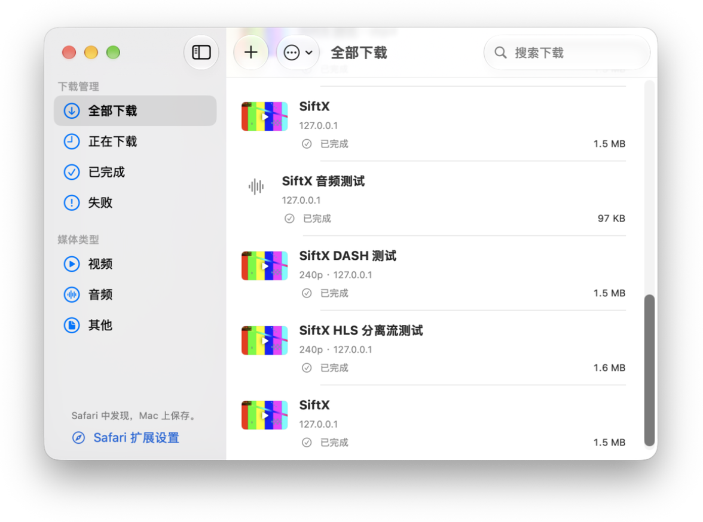
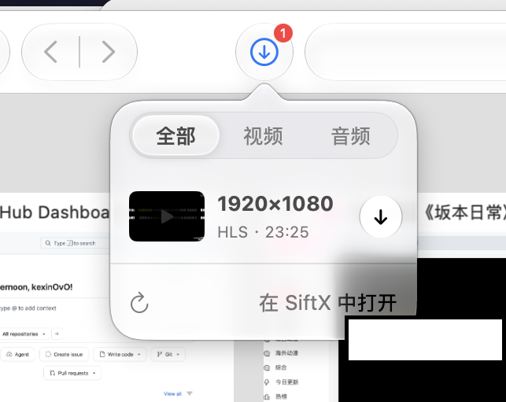

<p align="center">
  
</p>

<h1 align="center">SiftX</h1>

<p align="center">
  <sub>一款适用于 macOS 的下载工具，在 Safari 中发现媒体，在 Mac 上管理和保存下载。</sub>
</p>



## 功能

- **添加下载**：粘贴网页或媒体链接，读取可用选项并选择清晰度。
- **Safari 扩展**：浏览网页时查看可用的视频、音频，预览后添加下载。
- **管理任务**：查看进度，暂停、继续、取消或重试，支持同时下载多个任务。
- **整理记录**：按下载状态和媒体类型筛选，搜索历史记录。
- **查看文件**：播放已完成的视频或音频，打开文件或在 Finder 中定位。
- **个性设置**：选择保存位置、调整外观、设置完成通知与菜单栏显示。



## 使用

1. 打开 SiftX，点击 **＋** 添加网页或媒体链接。
2. 如需在 Safari 中使用，在 **Safari → 设置 → 扩展** 中启用 **SiftX Safari Extension** 和 **SiftX Media Probe**，并允许访问所需网站。
3. 打开网页并播放媒体，点击 Safari 工具栏中的 SiftX 图标，选择需要的内容。
4. 在 SiftX 中查看进度与下载记录；文件默认保存到“下载”文件夹，可在设置中更改。

## 开发与测试

本项目由 Swift/SwiftUI 主程序、原生 Safari Extension、Safari Web Extension（JavaScript 探针）以及 Swift Package 核心组成。最低部署目标为 **macOS 14**；工程的原生 App 构建目标为 **Apple Silicon (arm64)**。

推荐使用 Xcode 与 Swift 6，并安装 Node.js 22+、Python 3.11+。无需启动 Safari 的快速测试：

```sh
sh Scripts/test.sh
```

该命令运行 Swift 核心/状态/预览测试、Node.js 探针测试以及 Python 扩展配置检查。需要 FFmpeg 与本地 HTTP fixture 的下载集成测试须单独运行；部分预览测试在缺少 fixture 服务时会跳过。详见 [测试指南](docs/TESTING.md)。

欢迎参与改进，提交方式与工程生成注意事项参见 [贡献指南](CONTRIBUTING.md)。历史实机/功能验证记录见 [VERIFICATION.md](VERIFICATION.md)，不代表当前提交的 CI 结果。

## 使用须知

请仅下载您拥有版权或已获得授权的素材，并遵守相关法律法规及来源网站的使用条款。资源能否下载取决于其访问权限与可用状态。

## 免责声明

> 该工具仅供学习使用，下载的素材请在24小时内删除，任何个人行为与软件开发者无关。

该声明也可在 **SiftX → 设置 → 关于** 中查看。

第三方组件许可信息见 [第三方说明](THIRD_PARTY.md)。发布下载包内附有 `SiftX-ThirdParty-Sources.zip`，包含第三方源码、许可证、版本清单和构建说明；源码材料的维护方式见 [第三方源码说明](ThirdParty/README.md)。
